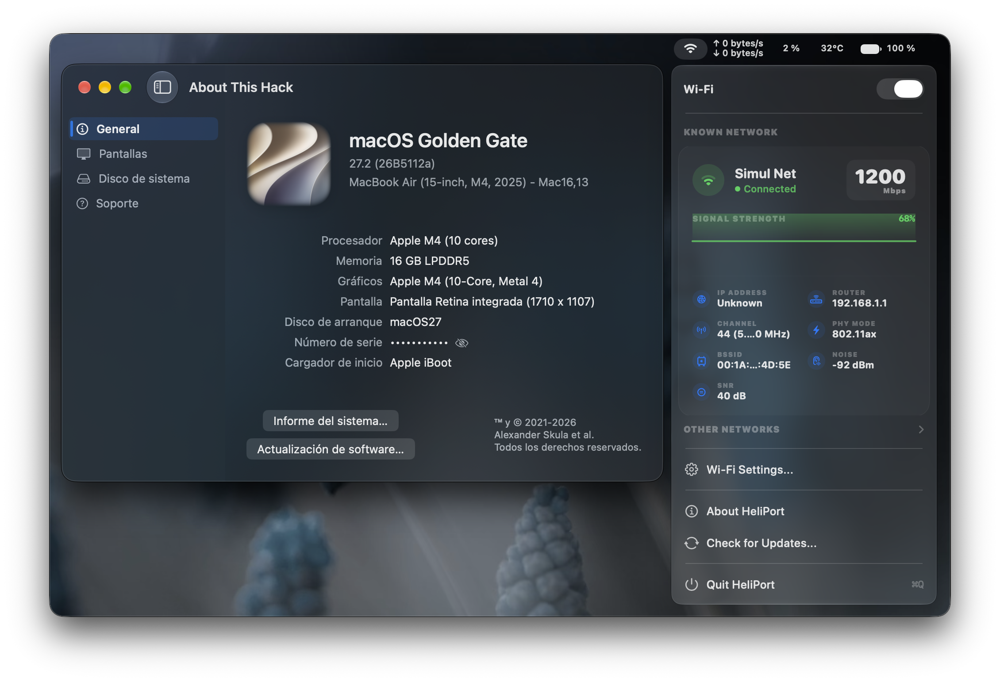
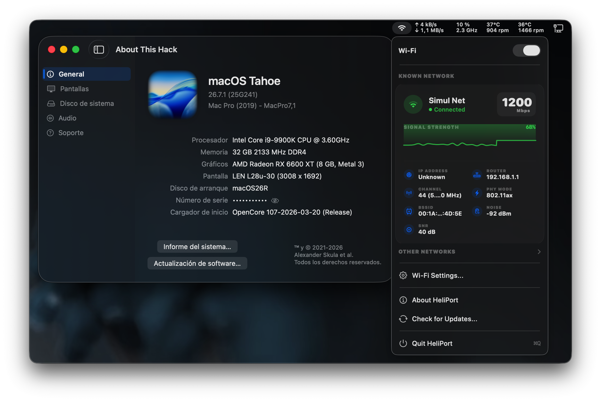

## Simulated Wi-Fi driver

HeliPort currently depends on `itlwm` ioctls, preventing meaningful UI testing without the kernel extension.

A simulated backend and the integration needed to select it while retaining host network details have been added. It's based on commit [3185d19](https://github.com/joshcalvert47/HeliPort/tree/3185d197941bf483253a48fc76d53e6f2e4b80af) from *joshcalvert47*'s HeliPort repository.

It adds a Preferences toggle, `--simulate` boot arg , Apple Silicon architecture support, and a host-interface setting for IP details. Simulation displays sample Wi-Fi data; it does not connect to Wi-Fi.

- **Driver routing:** Route scanning, connection, power, status, diagnostics, and shutdown through a shared itlwm/simulated driver facade
- **Simulation controls:** Add a General preferences toggle, missing-driver fallback, and configurable host BSD interface for IP details
- **Scope:** Simulation provides sample Wi-Fi state and networks; it does not establish a Wi-Fi connection
- **Apple Silicon:** Build for standard macOS architectures, including arm64
- **--simulate:** Launch simulation directly with:
  ```sh
  open /Applications/HeliPort.app --args --simulate
  ```

The utility of this functionality is that it allows you to work on the Heliport Xcode project on a computer that lacks `itlwm`. While you won't be able to work on the networking logic, you can still work on the UI—much in the same way you would when using a Hackintosh equipped with `itlwm`.

| Apple Silicon |
|:----|
|  |

| Hackintosh |
|:----|
|  |